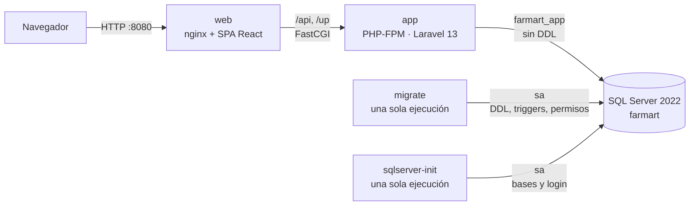
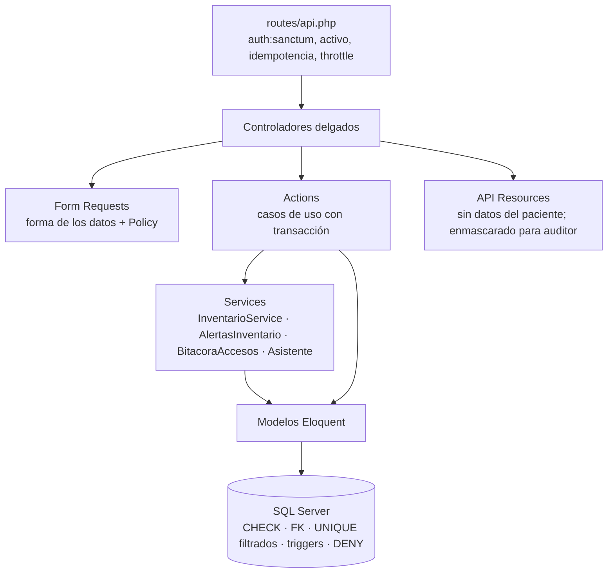
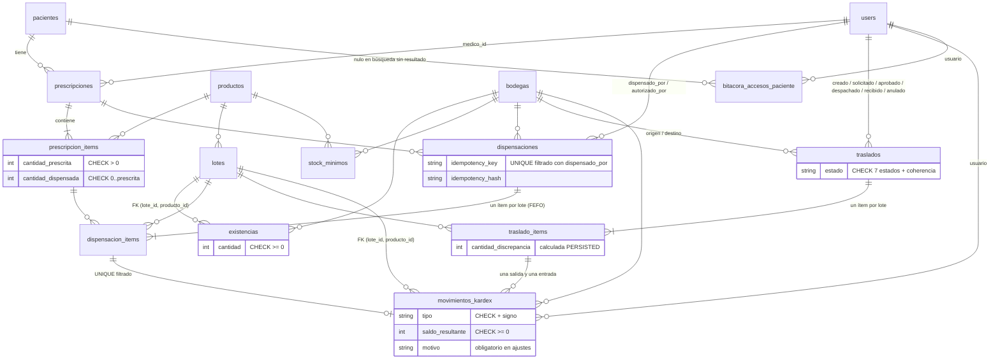
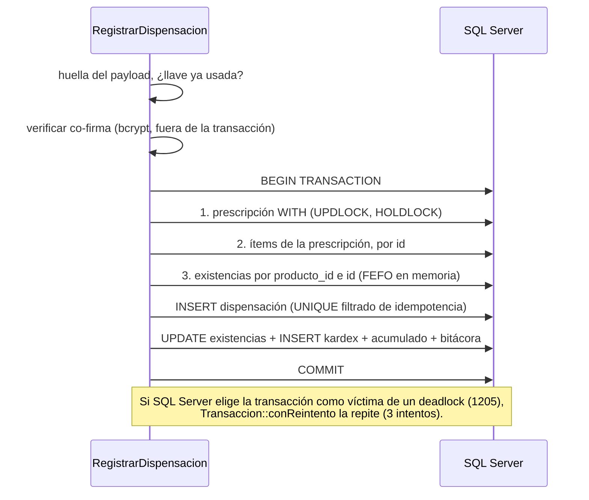

# Arquitectura

## Componentes

- **`web`** es el único puerto publicado: sirve la SPA y pasa `/api` y `/up` por FastCGI a `app`. Al
  haber un solo origen, no hace falta CORS.
- **`app`** se conecta como `farmart_app`, un usuario que solo lee y escribe datos. La clave de `sa` solo
  la reciben `sqlserver-init` y `migrate`.
- **El arranque se ordena con `depends_on`:** `sqlserver` (healthy) → `sqlserver-init` → `migrate`
  (completado con éxito) → `app` → `web`.

## Capas del backend

| Capa | Responsabilidad | Ejemplos |
|---|---|---|
| Form Request | Forma de los datos y autorización por rol (Policy) | `StoreDispensacionRequest`, `RecibirTrasladoRequest` |
| Action | Un caso de uso: transacción con reintento, orden de bloqueo y reglas de negocio | `RegistrarDispensacion`, `DespacharTraslado`, `RegistrarAjuste` |
| Service | Lógica reutilizable | `InventarioService` (único punto que cambia stock), `AlertasInventario` |
| Resource | Forma de la respuesta | `DispensacionResource`, `PacienteResource` (enmascara) |
| BD | Última barrera: lo que no depende de la fecha ni de otras tablas | `ck_existencias_cantidad`, triggers del kardex |

Los errores de negocio se lanzan como `ReglaNegocioException`, que se convierte en una respuesta 422,
403, 404, 409 o 429 con un `codigo` estable y no se registra en el log.

## Modelo de datos

**Tablas inmutables:** `movimientos_kardex` y `bitacora_accesos_paciente`.
- Tienen triggers `INSTEAD OF UPDATE/DELETE` que lanzan `THROW`.
- Además, `farmart_app` tiene `DENY UPDATE, DELETE` sobre ellas.

**Sin borrado en cascada:** SQL Server no admite varias rutas de cascada, y los documentos con historia
nunca se borran (`DENY DELETE`).

## Concurrencia

- **Orden global de bloqueo:** primero el documento (la prescripción o el traslado), luego sus ítems por
  id y por último las existencias por `producto_id` e id. Dispensaciones y traslados siguen el mismo
  orden, así que no se bloquean en orden cruzado.
- **`lockForUpdate` en SQL Server** genera `WITH (ROWLOCK, UPDLOCK, HOLDLOCK)`. El `HOLDLOCK` bloquea
  también el rango de índice, por lo que dos recepciones simultáneas no pueden crear la misma existencia.
- **Verificación:** la suite `tests/Concurrencia` lo prueba con procesos PHP paralelos. Sin el bloqueo,
  6 dispensaciones simultáneas sacan 18 unidades de un lote de 10 (una actualización perdida que el
  `CHECK` no detecta); con el bloqueo, solo pasan 3.
